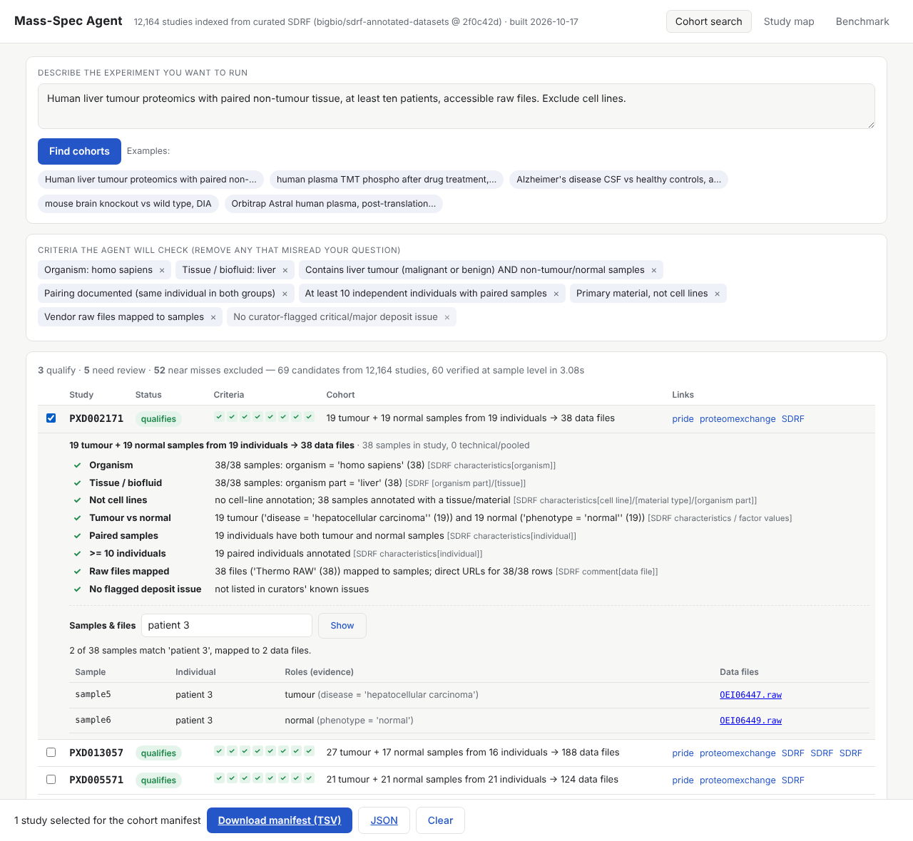
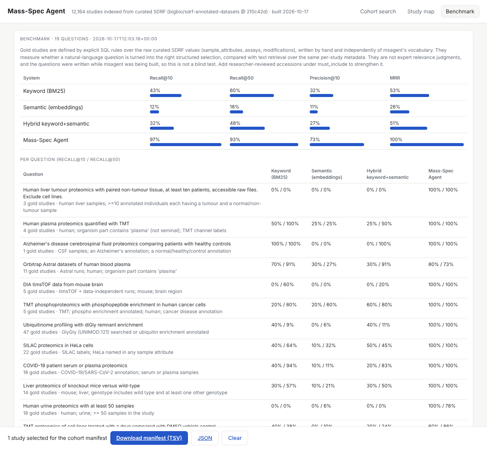
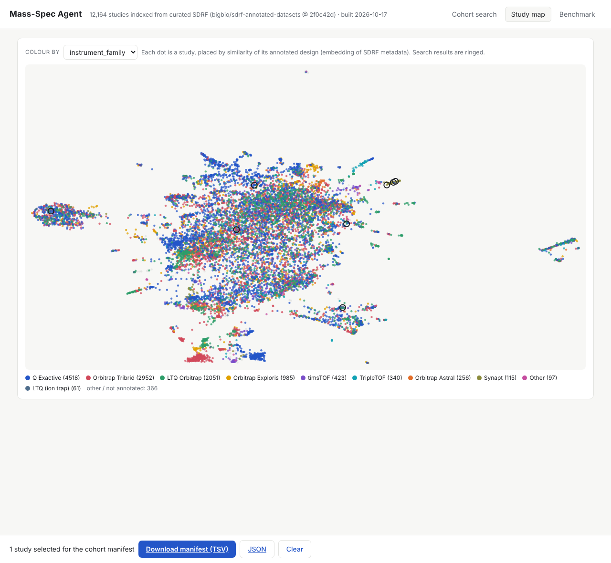

# Mass-Spec Agent

**Describe the experiment you want to run; get a defensible selection of public proteomics datasets, samples and files, with the evidence for why each one belongs.**

Mass-Spec Agent is a cohort-selection agent for public mass-spectrometry data (PRIDE / ProteomeXchange). It does not stop at "here are some relevant datasets". It turns your question into explicit criteria, then checks every candidate study against each criterion at the level of individual samples. Each check comes back **confirmed**, **excluded** or **unknown**, with the SDRF value that decided it. It keeps patients, biological samples, runs and files distinct, and it exports a sample-to-file manifest you can feed into a pipeline. Spectra are never downloaded; only metadata and file locations are indexed.



## Why this and not keyword search

Public repository metadata is inconsistent: `blood plasma` vs `plasma`, `TMT127N` vs `TMT 10-plex`, `q exactive hf` vs `Q Exactive HF`. The study-level text rarely says which raw file is "patient 3, adjacent normal". Keyword search and an LLM in front of a vector index can both find *topically similar* studies. Neither can tell you whether a study really has ≥10 patients with paired tumour and normal tissue, or which files those are.

The structured answer exists in **SDRF** (Sample and Data Relationship Format) annotations. The community has curated these for **12,164 ProteomeXchange/PRIDE datasets** ([bigbio/sdrf-annotated-datasets](https://github.com/bigbio/sdrf-annotated-datasets)): 596k samples and 732k runs, each row linking a sample's organism, tissue, disease, individual, treatment, genotype and label channel to its data file. Mass-Spec Agent turns that corpus into a queryable graph and puts a verifier on top.

## What a result looks like

```
$ msagent search "Human liver tumour proteomics with paired non-tumour tissue, at least ten patients, accessible raw files. Exclude cell lines."

Criteria:
  - Organism: homo sapiens
  - Tissue / biofluid: liver
  - Contains liver tumour (malignant or benign) AND non-tumour/normal samples
  - Pairing documented (same individual in both groups)
  - At least 10 independent individuals with paired samples
  - Primary material, not cell lines
  - Vendor raw files mapped to samples
  - No curator-flagged critical/major deposit issue  (safety)

69 candidates from 12164 studies -> verified 60: 3 qualify, 5 need review, 52 excluded  (3.0s)

PXD002171      QUALIFIES     [++++++++]  19 tumour + 19 normal samples from 19 individuals -> 38 data files
                + Tumour vs normal: 19 tumour ('disease = 'hepatocellular carcinoma'' (19)) and 19 normal ('phenotype = 'normal'' (19))
                + Paired samples: 19 individuals have both tumour and normal samples
                + >= 10 individuals: 19 paired individuals annotated
PXD013057      QUALIFIES     [++++++++]  27 tumour + 17 normal samples from 16 individuals -> 188 data files
PXD005571      QUALIFIES     [++++++++]  21 tumour + 21 normal samples from 21 individuals -> 124 data files
                + Tumour vs normal: 21 tumour ('disease = 'hepatocellular adenoma'' (21)) and 21 normal ('phenotype = 'non-tumoral liver'' (21))
                  [tumours annotated as adenoma (benign); check this fits the question]
PXD037021      NEEDS REVIEW  [+++???++]  52 samples (individuals not annotated) -> 52 data files
                ? Tumour vs normal: sample annotations do not state the groups needed for this comparison
                ? >= 10 individuals: individuals not annotated (no individual column); 52 biological samples is the upper bound
...
```

A few details that matter to a bioinformatician:

* In PXD002171 the normal samples carry the *patient's* disease (`hepatocellular carcinoma`), and only `phenotype = normal` marks them as non-tumour. The verifier reads that correctly.
* A benign adenoma cohort qualifies for "liver tumour" but is flagged, not hidden.
* When individuals are not annotated, a study with 6 samples is **excluded** from a "≥10 patients" request, because 6 samples cannot hold 10 patients. A study with 52 samples stays **unknown**, with 52 as the upper bound. Unknown is never counted as a pass.
* Pooled, QC, reference and synthetic samples are excluded from cohort counts. Likely-HeLa samples, annotated only as `cervical adenocarcinoma` with no patient, are treated as cell-line material.

Drill into one study to answer "which files are which":

```
$ msagent files PXD002171 --where "patient 3"
2 of 38 samples match 'patient 3', mapped to 2 data files.
- sample5  individual=patient 3  tumour (disease = 'hepatocellular carcinoma')
    OEI06447.raw    https://ftp.pride.ebi.ac.uk/pride/data/archive/2016/04/PXD002171/OEI06447.raw
- sample6  individual=patient 3  normal (phenotype = 'normal')
    OEI06449.raw    https://ftp.pride.ebi.ac.uk/pride/data/archive/2016/04/PXD002171/OEI06449.raw
```

Filters understand roles (`tumour`, `normal`, `treated`, `control`, `wild-type`, `knockout`) as well as literal values. They report any word that matched nothing, so it is never silently ignored. Then export the cohort:

```
$ msagent manifest PXD002171 PXD013057 -q "liver tumour with paired non-tumour tissue" -o out/liver_cohort.tsv
```

The TSV has one row per sample × data file, with group, the evidence for the group, individual, fraction, label channel, instrument, download URL (and where the URL came from) and key characteristics. Its header records the query, the per-criterion verdicts and the exact SDRF commit used.

## How it works

```
question ──► criteria (explicit, editable)
               │
               ├─► facet graph (DuckDB)        project → sample → run/file, normalised facets
               ├─► keyword index (BM25)         per-study metadata documents
               └─► semantic index (embeddings)  same documents, WordLlama by default
                       │
                       ▼
          shortlist (facet score + text relevance)
                       │
                       ▼
          sample-level verification ──► confirmed / excluded / unknown + evidence per criterion
                       │
                       ▼
          ranked: qualifies → needs review → near misses (with reasons) ──► manifest
```

| Module | Role |
|---|---|
| `msagent/sdrf.py` | SDRF parser: duplicate columns, `NT=…;AC=…` ontology cells, missing-value conventions |
| `msagent/ingest.py` | Builds `projects`, `assays` (one row per SDRF row), `sample_attributes`, `project_terms` (facet index), `modifications`, `known_issues` |
| `msagent/vocab.py` | Small, inspectable normalisation layer: instrument families, TMT plex from channels, DDA/DIA, PTM classes from UNIMOD, tissue and disease concepts, tumour/normal and control/wild-type markers, cell-line detection |
| `msagent/criteria.py` | Rule-based question → `Criteria` parser (organism, tissue, disease, comparison, pairing, counts, cell lines, instrument, label, acquisition, PTM, files, dates) |
| `msagent/verify.py` | The verifier: sample-level checks with evidence, group assignment, pairing, individual/sample/run counting |
| `msagent/cohort.py` | Two-stage retrieval (facet graph + hybrid text → verification) and ranking; `graph_query` |
| `msagent/project.py`, `manifest.py` | Study drill-down, sample → file map with role-aware filters, manifest export |
| `msagent/mcp_server.py` | MCP server (stdio) |
| `msagent/agent.py` | `msagent ask`: Claude driving the same tools |
| `msagent/web/` | FastAPI + a dependency-free single-page UI |
| `msagent/pride_api.py` | Optional enrichment from the PRIDE Archive API (titles, descriptions, dates, file listings) |

The "graph" is relational on purpose (DuckDB). Project → sample → assay → file relations and normalised facets give deterministic filtering. Embeddings handle wording the facets don't cover.

## Quick start

```bash
uv venv && source .venv/bin/activate        # Python >= 3.10
uv pip install -e ".[all]"                  # or: pip install -e ".[all]"

msagent build        # clone SDRF corpus (~750 MB), ingest (~2.5 min), index (~25 s), study map (~1 min)
msagent search "mouse brain knockout vs wild type, DIA"
msagent serve        # http://127.0.0.1:8000 (cohort search, study map, benchmark)
```

The built index lives in `data/` (git-ignored, about 210 MB). Everything runs offline after `msagent build`. The default WordLlama embedder ships its weights inside the PyPI wheel, so no model download is needed. For stronger semantic matching where Hugging Face is reachable, set `MSAGENT_EMBEDDER=fastembed:BAAI/bge-small-en-v1.5` and re-run `msagent index`.

### Use it from Claude (MCP)

```bash
claude mcp add msagent -- msagent-mcp          # Claude Code
```

For Claude Desktop, add `{"mcpServers": {"msagent": {"command": "msagent-mcp"}}}`. A project-level `.mcp.json` is included.

Tools: `interpret_question`, `find_cohorts`, `find_cohorts_structured`, `semantic_search`, `graph_query`, `list_facet_values`, `get_project`, `list_files`, `export_manifest`. The intended flow: interpret the question (the model can correct the criteria), find and verify, drill into files, export.

`msagent ask "…"` runs the same tools in a Claude tool-use loop. It needs Anthropic credentials (`ANTHROPIC_API_KEY`), uses `claude-opus-5-5` and enables server-side refusal fallback.

### Other commands

```
msagent criteria "…"            show how a question is interpreted
msagent project PXD002171       design, factor levels, counts, modifications, known issues, links
msagent files PXD… --where …    sample → file map
msagent manifest PXD… -q "…"    export cohort (TSV or --format json)
msagent enrich [--limit N]      add PRIDE metadata (needs network access to www.ebi.ac.uk), then `msagent index`
msagent bench [--pride-live]    run the benchmark (optionally against PRIDE's live search)
msagent status                  provenance of the current index
```

## Benchmark

`benchmarks/queries.yaml` has 19 natural-language questions. Each has a hand-written SQL rule over the raw SDRF values that defines its gold studies. `msagent bench` scores four systems over the same 12,164 studies:

| System | Recall@10 | Recall@50 | Precision@10 | MRR |
|---|---|---|---|---|
| Keyword search (BM25 over per-study metadata) | 0.43 | 0.60 | 0.32 | 0.53 |
| Semantic search (embeddings only) | 0.12 | 0.18 | 0.11 | 0.26 |
| Hybrid keyword + semantic | 0.32 | 0.48 | 0.27 | 0.51 |
| **Mass-Spec Agent** | **0.97** | **0.93** | **0.73** | **1.00** |

Per-question results are in `benchmarks/results.json` and in the UI's Benchmark tab. Recall@k is normalised by min(k, |gold|).

Read these numbers with the caveats:

* **The gold sets are rule-defined, not expert-judged.** They test whether a question is turned into the right structured selection. Because the agent filters on the same SDRF fields the rules use, part of its advantage is by construction. What the comparison does show is the value of interpreting questions into structured, verified filters rather than text similarity over the same metadata. A proteomics researcher should review a set of real questions; `must_include` in the YAML is there for reviewed accessions.
* **Not a blind test.** The questions were written while the system was being built.
* **The baselines are stand-ins.** "Keyword" is BM25 over our own per-study documents, not PRIDE's production search. `msagent bench --pride-live` scores PRIDE's real search API, but `www.ebi.ac.uk` was not reachable from the environment this was built in, so that column has not been run yet. The semantic baseline uses the small offline WordLlama model; a stronger embedder would do better.
* **Precision@10 below 1** is partly deliberate: when few studies qualify, the agent shows near misses with their exclusion reasons.



## Study map (the "embedding explorer" bolt-on)

The Study map tab is a UMAP of all 12,164 studies, coloured by instrument family, organism, label type, acquisition, tissue, disease or PTM, with current search results ringed. It embeds the annotated design, not spectra, so it shows which studies *look alike on paper*. It is an exploration aid, not evidence.



## Data, provenance and coverage

* **Source:** [bigbio/sdrf-annotated-datasets](https://github.com/bigbio/sdrf-annotated-datasets) (Apache-2.0), cloned by `msagent build` / `scripts/fetch_data.sh`. The commit is recorded in the index, in every manifest, and in SDRF links in results.
* **Curators' known-issues list** (`docs/known-issues.md` in that repo) is ingested. Critical and major deposits, such as a `.raw` that is really a 2 KB metadata stub, are excluded by default with the reason shown.
* **Coverage limits:** curated SDRF exists for about 21% of public ProteomeXchange datasets (about 28% of PRIDE). Of indexed studies, only about 6% annotate individuals, so many patient-count and pairing checks are honestly "unknown". Publication dates come from FTP paths for about 19% of studies; the rest need `msagent enrich`. SDRF rows carry direct file URLs for about 20% of studies; the rest resolve through the PRIDE file API.
* **PRIDE enrichment** (`msagent enrich`) adds titles, descriptions, protocols, dates and PRIDE's own file listing (categories, sizes, URLs), and lets protocol text confirm PTM enrichment. The client is written against the PRIDE v3 endpoints that `pridepy` uses (`/projects/{acc}`, `/projects/{acc}/files/all`, `/search/projects`), but it has **not been run against the live API yet**, because the build environment's network policy blocked `www.ebi.ac.uk`.

## Prior art and positioning

* PRIDE ships an [MCP server](https://glama.ai/mcp/servers/@PRIDE-Archive/mcp_pride_archive_search/inspect) over its keyword search. Its 2024 [chatbot](https://www.ebi.ac.uk/pride/chatbot/) ([paper](https://analyticalsciencejournals.onlinelibrary.wiley.com/doi/10.1002/pmic.202400005)) embeds titles, descriptions, protocols and SDRF text for dataset recommendation.
* OmicsDI cross-indexes PRIDE, GEO, ArrayExpress and others by keyword.
* The *Omics Data Discovery Agents* preprint ([2026](https://arxiv.org/html/2603.10161v1)) and [GEOAgent](https://github.com/JiekaiLab/GEOAgent) explore agentic discovery, compatibility checks and download-link generation.

The difference here is not "an LLM in front of PRIDE". It is **criterion-level verification at sample grain**: confirmed / excluded / unknown with evidence, correct counting of individuals vs samples vs runs vs fractions, sample-to-file manifests, and a benchmark that makes changes measurable. Whether that beats the tools above on real researcher questions still has to be shown by expert review.

## Roadmap

1. Run `msagent enrich` with PRIDE access and score `--pride-live` in the benchmark.
2. An expert-reviewed question set (`must_include`) and an evaluation of exclusion and unknown decisions, not just recall.
3. LLM-assisted interpretation for questions the rule-based parser misses, emitting the same `Criteria` object (the MCP route already allows this).
4. Infer missing fields from PRIDE protocols with explicit "inferred" status, never silently confirmed.
5. GEO / SRA ("BioData-Agent") using the same criteria → verify → manifest pattern.
6. Embedding model-comparison workbench (scGPT / Geneformer / UCE vs PCA baselines) as a separate project.

## Development

```bash
uv pip install -e ".[all]"
python -m pytest -q        # 16 tests on a synthetic SDRF corpus; no network or full build needed
```
